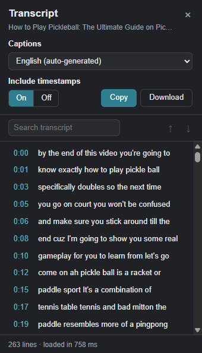

# yt-transcriber

**Read, search and copy the transcript of any YouTube video, with clickable timestamps. Works as a Chrome extension on desktop and as a bookmarklet on iPhone and iPad.**

TypeScript · React 19 · Chrome Manifest V3 · esbuild · Node test runner · Vercel · no backend, no API keys, $0 to run



*The Chrome popup: pick a caption track, search, click any timestamp to jump there, or copy/download the text.*

## Why I built it

A lot of what I learn comes from YouTube: lectures, tutorials, long talks. Often I don't want to rewatch a 40-minute video to find one explanation. I want to skim it, search it for a word, or paste a section into my notes. YouTube has a "Show transcript" panel, but it's buried, it isn't searchable, it's awkward to copy from, and it's even harder to use on a phone.

This is the follow-up to my other YouTube extension, [YTBookmarks](https://github.com/tanthai028/YTBookmark), which marks moments in a video. This one makes a video's words searchable. I set strict rules: use only YouTube's own captions, no server, no paid APIs, and never alter or invent text.

## The interesting problem

The first obstacle: every caption request came back **empty**. YouTube now requires a proof-of-origin token (`pot`) on caption URLs, minted inside its own player. That change in 2026 broke most of the tutorials and open-source libraries I'd normally have leaned on.

Instead of trying to forge tokens, I changed approach: let YouTube's player do the work and observe it.

1. A small script runs in the page from the very start and watches the caption requests the player itself makes, remembering each one (with its token) per video.
2. To fetch a track, it takes that track's signed URL from the player and adds the parameters from the player's own request.
3. If the player hasn't loaded captions yet, it switches CC on through the player's API, waits for the request, then restores your CC setting.
4. If YouTube still returns nothing, it falls back to opening YouTube's transcript panel and reading that.

Observed on live YouTube during development (not a formal benchmark): a 23-minute auto-generated transcript (817 lines) loads in about 90 ms, and a cached 47-minute video in about 41 ms.

## What it does

- **Transcript with clickable timestamps.** Click any line to jump the video there.
- **Search** with highlighted matches and keyboard navigation ("3 / 17").
- **Caption track picker:** creator captions vs. auto-generated, with a sensible default for your language.
- **Copy or download as TXT**, with or without timestamps.
- **Local cache** (8 MB, least-recently-used eviction, 30-day expiry) so reopening is instant.
- **iPhone and iPad:** a bookmarklet, installed from a static page on Vercel, that opens the same transcript panel on the YouTube site in Safari.
- **Shortcut:** Alt+T on desktop.

## Engineering highlights

- **All YouTube-specific code is isolated in [`src/extractor/`](src/extractor/).** When YouTube changes something, there's one place to fix. The UI only sees a small interface: `getVideoInfo`, `getTranscript`, `seekTo`.
- **One extractor, two products.** The Chrome extension and the iPhone bookmarklet share the same page-side code; esbuild builds both from one `build.mjs`.
- **Pure parsers, tested against real responses.** 57 unit tests run on Node's built-in test runner, with saved real YouTube responses as fixtures (JSON3 and XML captions, manual and auto-generated tracks).
- **Errors over wrong answers.** If a response is empty, cut off or unreadable, the user gets a specific error explaining which part failed, never a partial transcript.
- **Privacy by design.** Every request goes to `www.youtube.com`, made the same way the page makes it. Nothing is collected or sent anywhere else.
- **Honest documentation.** Known limitations and unverified paths are written down below, along with a [manual test checklist](docs/manual-test-checklist.md) for live testing.

## What I learned

- **Don't fight the platform; observe it.** Reverse-engineering the token would have been fragile and against the spirit of the project. Watching the player's own network requests was simpler, more robust, and needed no secrets.
- **Isolate what will break.** Building on undocumented internals means breakage is a matter of when, not if. Putting all of it behind one module boundary, with fixture tests, turns a future outage into a small, local fix.
- **Real data beats assumptions.** Saving real YouTube responses as test fixtures kept the parsers honest about what YouTube actually sends, including the differences between manual and auto-generated captions.
- **Mobile is a different world.** Getting the bookmarklet working in iPhone Safari meant handling the mobile site, Shorts, `youtu.be` links and other URL formats, plus Safari quirks like bookmarklets only running from the Bookmarks list.

## Tech stack

- **TypeScript** throughout, **React 19** for the popup UI, plain DOM for the bookmarklet
- **Chrome Extension Manifest V3** (content script, page-world script, popup)
- **esbuild** for both builds, **Vercel** for the static bookmarklet site
- **Node's built-in test runner** with real-response fixtures
- `chrome.storage.local` for the cache

## Run it locally

Requires Chrome 111+ and Node 24+ (the tests use Node's built-in TypeScript support).

```bash
npm install
```
```bash
npm run build
```

Then in Chrome:

1. Open `chrome://extensions` and turn on **Developer mode** (top right).
2. Click **Load unpacked** and select the `dist` folder.
3. **Reload any YouTube tabs that were already open.** The extension only attaches to pages loaded after it's installed.
4. Pin the extension from the puzzle-piece menu so its icon sits in the toolbar.

**Updating after a code change:** `npm run build`, click the reload arrow on the extension's card in
`chrome://extensions`, then reload the YouTube tab. `npm run watch` rebuilds on every save.

## Using it

<details>
<summary>Chrome extension: usage</summary>

On a `youtube.com/watch` page, click the toolbar icon or press **Alt+T**. The transcript opens in a
popup directly under the icon. Like any Chrome extension popup, it closes when you click elsewhere
(including the video); reopen it and the transcript comes back instantly from the cache.

- **Click a timestamp** to jump the video there (the popup stays open).
- **Search** highlights every match and shows "3 / 17"; Enter / Shift+Enter or ↓ / ↑ step through them.
- **Captions**: pick a track. Creator-uploaded tracks are listed under "Captions", YouTube's speech
  recognition under "Auto-generated". The default is a manual track in your browser language, then an
  auto-generated one in your language, then any manual track.
- **Include timestamps On / Off**: applies to both Copy and Download, and is remembered.
- **Copy** puts one caption per line on the clipboard. **Download** saves `Title [videoId].txt` with
  the title, link and track name at the top.
- The footer shows the line count and how long the load took ("from cache" when cached). Each load
  also logs a timing breakdown to the popup's console (right-click the popup → Inspect), prefixed
`[yt-transcriber]`.

</details>

<details>
<summary>iPhone, iPad and other browsers (bookmarklet): deploy and install</summary>

The `dist-web/` build is a static site: an install page plus `bookmarklet.js`. The bookmarklet you save
is a few hundred characters long. When you tap it on a YouTube video, it downloads the latest
`bookmarklet.js` from your site and runs it inside the YouTube page. That page-side code is the same
as the extension's, so it reaches the player the same way. Captions still come only from YouTube, and
nothing is sent to your site except the request for the script.

**Deploy to Vercel (free Hobby plan)**

```bash
npx vercel login
```
```bash
npx vercel --prod
```

`vercel.json` already sets the build (`npm run build`), the output folder (`dist-web`), and the CORS
header that lets the YouTube page download `bookmarklet.js`. The first deploy asks for a project name:
`yt-transcriber` gives `yt-transcriber.vercel.app` if that name is free. Run `npx vercel --prod` again
after changes; bookmarklets pick up the new code automatically.

**Install on iPhone or iPad**

1. Open your site in Safari and tap **Copy bookmarklet**.
2. Bookmark that page: Share → **Add Bookmark** → Save.
3. Open the Bookmarks list → **Edit** → tap the new bookmark. Rename it `YT Transcript`, replace its
   address with the copied code, and tap **Done**.

On a computer, drag **YT Transcript** from the install page to the bookmarks bar.

**Use on iPhone or iPad**

1. Open the video in **Safari**, not the YouTube app. All of these work, on the mobile site
   (`m.youtube.com`, the iPhone default) and the desktop site (the iPad default):
   `youtube.com/watch?v=…`, Shorts (`/shorts/…`), `youtu.be/…` links, `/live/…`, and links with
   `&t=`, `&list=` or `&si=`. The video doesn't need to be playing.
2. Open the **Bookmarks list** (book icon; on iPhone it's under the tabs or ⋯ button) and tap
   **YT Transcript** there. Don't start it from the address bar: Safari blocks bookmarklets started
   that way and shows "Cannot Run Script".
3. The panel appears at the top right. Tap a timestamp to seek; tap the bookmark again to hide or show it.

If something fails, the panel's grey detail line says what it detected: the page, the URL type, and
where it looked for the video ID.

</details>

## Project structure

```
manifest.json               MV3 manifest
build.mjs                   esbuild: extension → dist/, bookmarklet + install page → dist-web/
vercel.json                 static hosting config for dist-web/ (CORS header for bookmarklet.js)
web/index.html              bookmarklet install page
src/extractor/              ALL YouTube-specific logic; when YouTube changes, fix it here
  index.ts                  public interface used by the UI: getVideoInfo, getTranscript, seekTo
  player.ts                 runs inside the page: reads the player, observes caption requests, fetches
  page-bridge.ts            extension only: exposes player.ts to the content script via postMessage
  parsers.ts                pure: player response → tracks; json3/XML → lines; URL building
  panel-fallback.ts         opens and reads the "Show transcript" panel
  panel-parsers.ts          pure: panel JSON / panel rows → lines
  protocol.ts, errors.ts, types.ts
src/bookmarklet/index.ts    bookmarklet: the transcript panel on the YouTube page (plain DOM, no React)
src/content/index.ts        content script: relays popup requests to the extractor (draws nothing on YouTube)
src/popup/                  the popup UI (React): App.tsx, styles.ts, rpc.ts (talks to the tab)
src/rpc.ts                  popup ↔ content script message types
src/cache.ts                chrome.storage.local cache
src/format.ts, search.ts    timestamps, TXT export, transcript search
test/                       unit tests; test/fixtures/ holds real YouTube responses
docs/manual-test-checklist.md
scripts/capture-transcript-panel.js   dev helper for checking the panel fallback
```

| Command | What it does |
|---|---|
| `npm run build` | Build the extension (`dist/`) and the website (`dist-web/`) |
| `npm run watch` | Rebuild on change (unminified, with source maps) |
| `npm test` | Unit tests: parsers against saved YouTube responses, cache, export formatting |
| `npm run typecheck` | `tsc --noEmit` |

Before trusting a new build, run [docs/manual-test-checklist.md](docs/manual-test-checklist.md).

## Permissions and privacy

- `https://www.youtube.com/*`: run on YouTube and request captions from it.
- `storage`: the transcript cache and your timestamp setting.

Every network request goes to `www.youtube.com`, made the same way the page itself makes it. The
bookmarklet also downloads its own code from your Vercel site. Nothing else is sent anywhere, and all
data stays in your browser. The cache holds up to 8 MB; when it's full,
the transcript you opened least recently is removed first, and entries expire after 30 days.

## Known limitations

- **Panel fallback unverified.** It was written against known structures of YouTube's transcript
  panel and its `get_transcript` response, but hasn't been checked against the live panel (October 2026).
  Its JSON test uses a hand-written sample. To verify, run
  [scripts/capture-transcript-panel.js](scripts/capture-transcript-panel.js) on a video page and update
  the selectors and fixture. A panel transcript may be in a different language than the selected track,
  and it isn't cached.
- **Briefly toggles CC.** When the player hasn't loaded captions for a video yet, the extension turns
  CC on and back off, which can flash captions for a moment.
- **Captions only.** Videos without captions (or with captions disabled by the creator; YouTube reports
  both the same way) have no transcript. Audio transcription is out of scope for v1.
- **Live streams and premieres** aren't supported until they've ended and been processed.
- **Sites:** the extension runs on `www.youtube.com` (watch pages and Shorts). The bookmarklet also runs
  on `m.youtube.com`. Both were tested on live YouTube by emulating a phone in desktop Chrome, not in
  real iPhone Safari, except for a check on a real iPhone that confirmed Safari runs it when started from the Bookmarks list.
  The bookmarklet has no cache and no Alt+T shortcut, and if YouTube ever restricts which Trusted Types
  policies pages may create, the loader will stop working.
- **Age-restricted videos** need you to be signed in with an age-verified account.
- **The popup closes when you click outside it.** That's how Chrome extension popups work. Clicking
  timestamps inside it keeps it open; reopening is instant thanks to the cache.
- **Depends on YouTube internals** (player API, request format). A YouTube update can break it; the
  error messages say which part failed.
- **Translations:** YouTube's auto-translate languages aren't offered (the code supports `tlang`, but the
  UI doesn't expose it yet).

## Possible later work

- Audio transcription for videos without captions (e.g. local faster-whisper).
- Auto-translated tracks in the Captions menu.
- Highlighting the current line during playback.

## Troubleshooting

<details>
<summary>Common problems and fixes</summary>

| Symptom | Fix |
|---|---|
| "Reload this YouTube tab…" | The tab was opened before the extension was installed or reloaded. Reload it. |
| Alt+T does nothing | Another extension may use it; change it at `chrome://extensions/shortcuts`. |
| "Waiting for the player…" | An ad is playing or the video hasn't started. Let the video play, then open the popup again. |
| "YouTube returned no caption data… press play once" | The player never loaded captions. Play the video for a second, then reopen the panel. |
| "YouTube returned no caption data" (other) | YouTube blocked the caption request and the panel fallback failed too. Reload the tab and retry; if it persists, YouTube changed something. See below. |
| "YouTube's page structure has changed…" | The player API or markup the extension relies on moved. Fix `src/extractor/` (start with the detail line shown under the message). |
| Transcript looks out of date | Captions were edited after caching. Clear the cache: right-click the popup → Inspect, and in that console run `chrome.storage.local.clear()`. |
| Bookmarklet: "Cannot Run Script" (Safari) | You started it from the address bar. Open the Bookmarks list and tap it there. |
| Bookmarklet: nothing happens | Make sure you're on YouTube in Safari, not the YouTube app, and that the bookmark's address starts with `javascript:`. |
| Bookmarklet: "works on YouTube pages; this page is …" | The alert names the page it ran on; open the video on youtube.com first. |
| Bookmarklet: "Open a YouTube video…" with a grey detail line | The detail says what was checked (e.g. `m.youtube.com/feed/trending: not a video page`). If it names a real video page, please open an issue with that line. |
| Bookmarklet: "could not load" | Your Vercel site is unreachable, or `bookmarklet.js` lacks the CORS header. Open `https://<your-site>/bookmarklet.js` to check it loads. |
| Wrong language | Pick another track in the Captions menu. If the note says it came from the transcript panel, the panel uses its own language choice. |

**When YouTube changes:** check the page console for `[yt-transcriber]` lines, then work in
`src/extractor/`. The pure parsers have fixture tests. Save a new real response in `test/fixtures/`
and add a test before changing a parser.

</details>

## About

Built by **Tan Thai**. | [LinkedIn](https://linkedin.com/in/tanthai028) | [GitHub](https://github.com/tanthai028)

Other projects: [YTBookmarks](https://github.com/tanthai028/YTBookmark) (bookmarks on YouTube's timeline, on the Chrome Web Store) · [Stride](https://github.com/tanthai028/stride-desktop-app) · [RJ Job Tracker](https://github.com/tanthai028/RJTracker)
